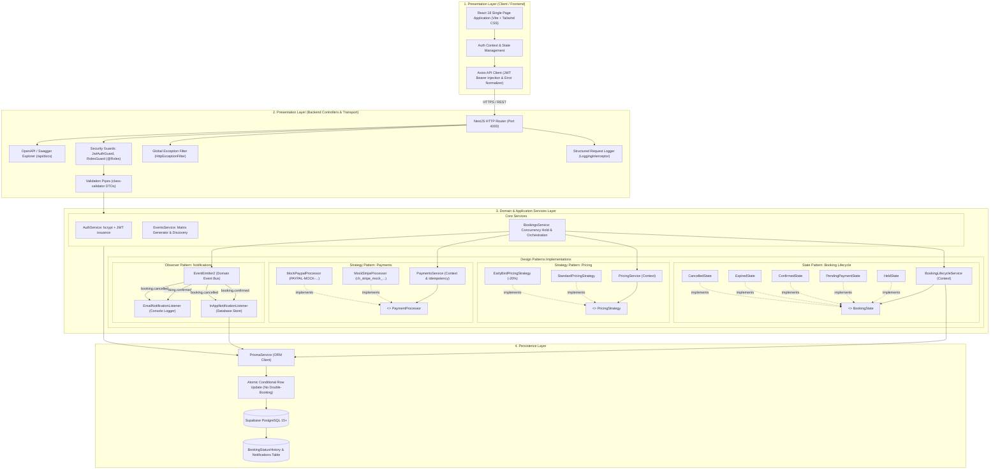
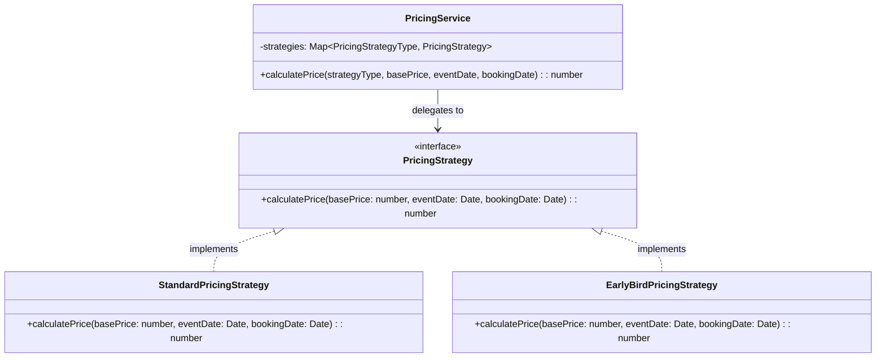
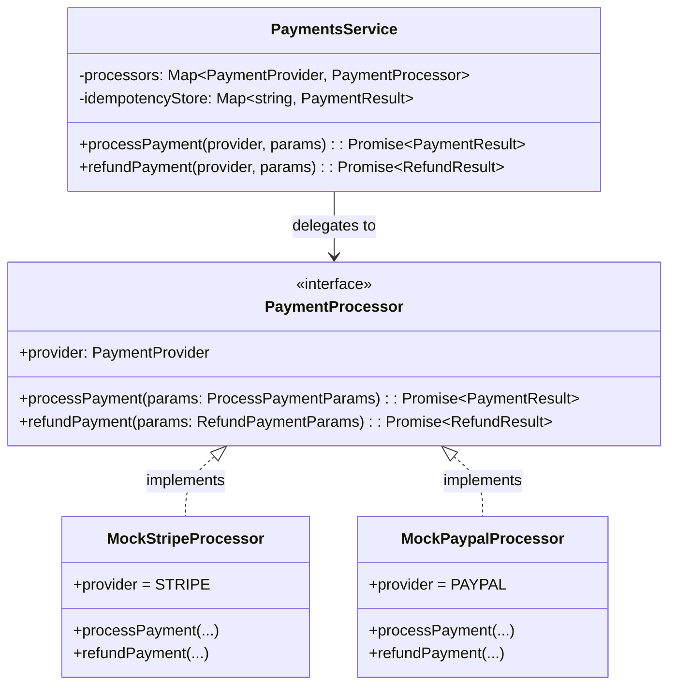
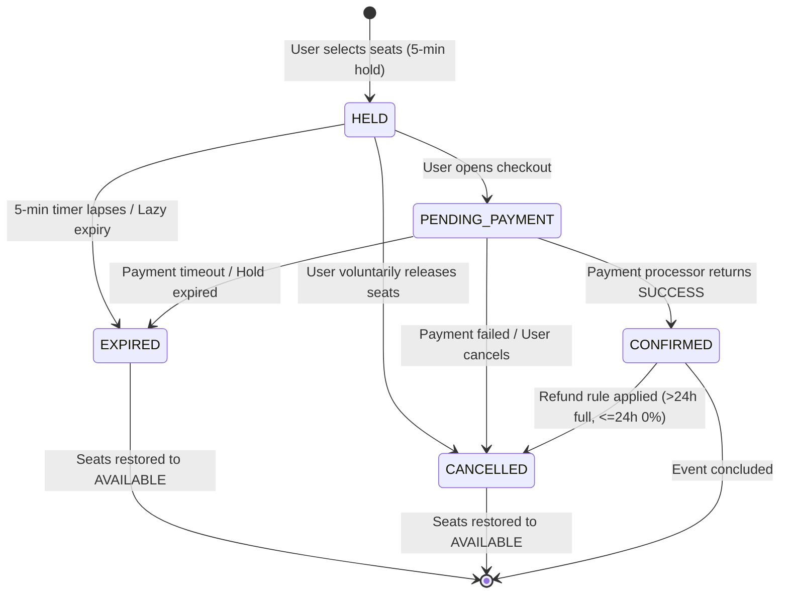
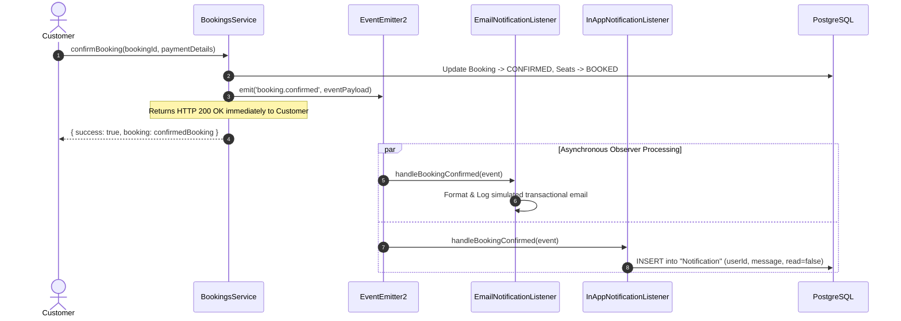

# TicketFlow — System Architecture & Design Patterns

TicketFlow is an enterprise-grade, high-concurrency event ticketing platform modeled after systems like Ticketmaster and BookMyShow. It is engineered with a strict **Clean 3-Tier Layered Architecture**, textbook **Gang of Four (GoF) Design Patterns**, absolute **SOLID principles**, and **ACID-compliant concurrency control** to prevent double-booking under high simultaneous load.

---

## 1. High-Level System Architecture

TicketFlow follows a strict **3-Tier Layered Architecture** where dependencies point strictly downward:  
`Presentation Layer` $\rightarrow$ `Domain Services Layer` $\rightarrow$ `Persistence Layer`.



---

## 2. Layered Architecture Separation

| Layer | Files / Modules | Responsibilities & Boundaries |
|---|---|---|
| **Presentation (Frontend)** | `frontend/src/pages/`, `frontend/src/components/`, `frontend/src/services/api.ts` | React 18 UI components, interactive seat matrix rendering, real-time 5-minute countdown timer, role-based navigation, 1-click quick demo login chips. |
| **Presentation (Backend)** | `src/modules/*/controllers/`, `src/common/filters/`, `src/common/interceptors/` | REST route mapping, OpenAPI documentation, request payload DTO validation (`ValidationPipe`), JWT authentication (`JwtAuthGuard`), role-based authorization (`RolesGuard`), centralized error response transformation. No business logic resides in controllers. |
| **Domain Services** | `src/modules/*/services/`, `src/modules/pricing/`, `src/modules/payments/`, `src/modules/bookings/lifecycle/` | Pure business logic, pricing calculation algorithms, payment execution, booking state machine transitions, event emission, refund policy calculation. Completely decoupled from HTTP transport. |
| **Persistence Layer** | `backend/prisma/schema.prisma`, `src/prisma/prisma.service.ts` | Relational database schema, connection pooling, transactional boundaries (`$transaction`), atomic conditional SQL updates, and audit log persistence. |

---

## 3. Design Patterns Deep Dive

### 3.1. Strategy Pattern: Dynamic Pricing
- **Problem**: Ticket pricing rules vary across events. Some events require fixed pricing, while others apply early-bird discounts depending on how far in advance a customer reserves. Future requirements may introduce surge pricing or VIP member tiers.
- **Solution**: Encapsulated the pricing algorithm inside a `PricingStrategy` interface. The `PricingService` acts as the strategy context, dynamically executing the strategy configured by the organizer on the event record.
- **Key Classes**:
  - Interface: `PricingStrategy` (`calculatePrice(basePrice, eventDate, purchaseDate): number`)
  - Strategies: `StandardPricingStrategy` (1.0x multiplier), `EarlyBirdPricingStrategy` (20% discount if booking is created $\ge 7$ days prior to event start).
  - Context: `PricingService` (injects strategy instances via NestJS DI and routes requests).
- **Extensibility**: Adding a new pricing strategy (e.g., `LastMinuteSurgePricingStrategy`) requires creating a single class implementing `PricingStrategy` and registering it in the DI container. Zero modifications are needed in `BookingsService` or `EventsService`.



---

### 3.2. Strategy Pattern: Pluggable Payment Gateways
- **Problem**: Modern ticketing platforms must support multiple payment processors (Stripe, PayPal, Apple Pay, bKash) and switch providers without touching core booking logic. Furthermore, checkout requests must be idempotent to prevent double charges on network timeouts.
- **Solution**: Implemented a common `PaymentProcessor` interface. The `PaymentsService` routes the payment request to the chosen processor based on client request or organizer preference, and enforces idempotency key caching.
- **Key Classes**:
  - Interface: `PaymentProcessor` (`processPayment(params): Promise<PaymentResult>`, `refundPayment(params): Promise<RefundResult>`)
  - Concrete Processors: `MockStripeProcessor` (generates `ch_stripe_mock_...`), `MockPaypalProcessor` (generates `PAYPAL-MOCK-...`).
  - Context & Guard: `PaymentsService` maintains an in-memory idempotency cache (`Map<string, PaymentResult>`) and database-backed booking state check.
- **Extensibility**: To add a production gateway (e.g. `BraintreeProcessor`), implement `PaymentProcessor` and register it in `payments.module.ts`. The rest of the platform remains unchanged.



---

### 3.3. State Pattern: Booking Lifecycle Management
- **Problem**: A booking moves through an explicit lifecycle (`HELD` $\rightarrow$ `PENDING_PAYMENT` $\rightarrow$ `CONFIRMED` / `CANCELLED` / `EXPIRED`). Allowing arbitrary transitions (e.g. paying for an already cancelled or expired booking) creates critical security and data integrity vulnerabilities.
- **Solution**: Implemented the State Pattern. Every lifecycle state is represented as an independent state class conforming to `BookingState`. State objects define their valid outward transitions and throw meaningful domain exceptions when an invalid transition is attempted.
- **Key Classes**:
  - Interface: `BookingState` (`status: BookingStatus`, `canTransitionTo(targetStatus): boolean`, `onTransition(bookingId, context): Promise<void>`)
  - Concrete States: `HeldState`, `PendingPaymentState`, `ConfirmedState`, `ExpiredState`, `CancelledState`.
  - Context: `BookingLifecycleService` coordinates state transitions, persists transition audit records in `BookingStatusHistory`, and guarantees lifecycle consistency.



#### Transition Matrix

| From State \ To State | `HELD` | `PENDING_PAYMENT` | `CONFIRMED` | `EXPIRED` | `CANCELLED` |
|---|:---:|:---:|:---:|:---:|:---:|
| **`HELD`** | — | ✅ Allowed | ❌ Invalid | ✅ Allowed | ✅ Allowed |
| **`PENDING_PAYMENT`** | ❌ Invalid | — | ✅ Allowed | ✅ Allowed | ✅ Allowed |
| **`CONFIRMED`** | ❌ Invalid | ❌ Invalid | — | ❌ Invalid | ✅ Allowed (Refund Rule) |
| **`EXPIRED`** | ❌ Invalid | ❌ Invalid | ❌ Invalid | — | ❌ Terminal |
| **`CANCELLED`** | ❌ Invalid | ❌ Invalid | ❌ Invalid | ❌ Terminal | — |

---

### 3.4. Observer Pattern: Decoupled Event Notifications
- **Problem**: When a booking is confirmed or cancelled, multiple secondary actions must occur: sending an email notification, recording an in-app inbox notification, updating organizer metrics. Coupling these side effects inside the booking transaction slows down checkout, violates Single Responsibility, and causes checkout failure if an email server is temporarily unreachable.
- **Solution**: The booking service dispatches domain events (`booking.confirmed`, `booking.cancelled`) through an asynchronous event bus (`EventEmitter2`). Listeners subscribe to these events independently.
- **Key Classes**:
  - Event Bus: `@nestjs/event-emitter` (`EventEmitter2`)
  - Events: `BookingConfirmedEvent`, `BookingCancelledEvent`
  - Observers / Listeners:
    - `EmailNotificationListener`: Simulates structured email dispatch with formatted console logging.
    - `InAppNotificationListener`: Asynchronously stores an in-app alert in the `Notification` database table.



---

## 4. Concurrency Control: Zero Double-Booking Guarantee

### The Race Condition Challenge
In ticket booking systems, peak demand (flash sales) causes thousands of users to click the exact same front-row seat at the exact same millisecond. Traditional naive read-then-write code causes **double-booking**:
```typescript
// ❌ NAIVE IMPLEMENTATION (RACE CONDITION VULNERABLE):
const seat = await prisma.seat.findUnique({ where: { id: seatId } });
if (seat.status === 'AVAILABLE') {
  // Concurrency window: User B reads status as AVAILABLE before User A completes update!
  await prisma.seat.update({ where: { id: seatId }, data: { status: 'HELD' } });
}
```

### TicketFlow's Solution: Atomic Conditional SQL Updates
TicketFlow executes an **atomic conditional update** directly in the database engine using row-level locking. The database evaluates the condition and applies the lock in a single atomic CPU instruction:

```sql
UPDATE "Seat"
SET 
    "status" = 'HELD',
    "heldByUserId" = $1,
    "holdExpiresAt" = NOW() + INTERVAL '5 minutes',
    "version" = "version" + 1
WHERE 
    "id" = $2
    AND (
        "status" = 'AVAILABLE' 
        OR ("status" = 'HELD' AND "holdExpiresAt" < NOW())
    );
```

### Why this approach is superior:
1. **Zero External Overhead**: Unlike distributed Redis locks (Redlock), it requires no external infrastructure, eliminating network round-trips and connection pool exhaustion.
2. **PostgreSQL MVCC Safety**: PostgreSQL automatically locks only the target row (`FOR UPDATE` semantics). Other seats in the venue are unaffected, preserving maximum concurrency across the grid.
3. **Deterministic Exactly-One Winner**: If 10 requests hit the database simultaneously for the exact same seat, PostgreSQL serializes the row update. Exactly **one** transaction updates 1 row; the other 9 match 0 rows and immediately receive `409 ConflictException`.
4. **Verified via Automated Concurrency Tests**: Verified by `backend/test/concurrency-hold.spec.ts` executing 10 parallel asynchronous promises against a single seat.

---

## 5. Lazy (Just-In-Time) Expiration Architecture

### Why Background Polling Crons Fail on Modern Clouds
A common design pattern is a background cron worker (`setInterval` or `@nestjs/schedule`) polling the database every 10 seconds to find expired seats.  
**Critical Production Flaw**: On free or auto-scaling cloud tiers (Render, Railway, Fly.io), containers enter a sleep mode after 15 minutes of inactivity. When the container sleeps, the cron timer freezes. Seats held by users who abandoned checkout remain permanently locked in `HELD` state until another HTTP request wakes the server.

### TicketFlow's Resilient Lazy Evaluation
TicketFlow uses **Lazy (Just-In-Time) Expiration**:
1. When any customer queries the seat map (`GET /events/:id/seats`), any seat with `status = 'HELD'` and `holdExpiresAt < NOW()` is dynamically projected as `AVAILABLE`.
2. When any customer attempts to hold a seat (`POST /bookings/hold`), the atomic conditional update explicitly checks:
   ```sql
   WHERE "status" = 'AVAILABLE' OR ("status" = 'HELD' AND "holdExpiresAt" < NOW())
   ```
If the previous user's 5-minute hold has expired, the new user immediately and seamlessly acquires the seat without needing any background worker.

---

## 6. Cancellation & Refund Business Rule Engine

TicketFlow enforces the contest's strict cancellation policy:
$$\text{Refund Rule} = \begin{cases} 100\% \text{ Full Refund} & \text{if } (T_{\text{event\_start}} - T_{\text{cancellation}}) > 24 \text{ hours} \\ 0\% \text{ Non-Refundable} & \text{if } (T_{\text{event\_start}} - T_{\text{cancellation}}) \le 24 \text{ hours} \end{cases}$$

### Execution Flow:
1. Customer initiates cancellation via `POST /bookings/:id/cancel`.
2. `BookingsService` verifies the booking belongs to the authenticated customer and is currently in `CONFIRMED` status.
3. Computes the millisecond delta: `hoursRemaining = (eventDate.getTime() - now.getTime()) / (1000 * 60 * 60)`.
4. If `hoursRemaining > 24`, calculates `refundAmount = totalAmount`; otherwise `refundAmount = 0`.
5. Executes payment gateway refund via `PaymentsService.refundPayment(processor, ...)`.
6. Transitions state machine: `BookingLifecycleService.transitionTo(bookingId, BookingStatus.CANCELLED, reason)`.
7. Within a database transaction, all associated seats are reset to `AVAILABLE` with nullified hold timestamps.
8. Dispatches `booking.cancelled` domain event to notify user via email log and in-app alert.

---

## 7. SOLID Principles Compliance Matrix

| Principle | Meaning & Intent | Specific Implementation in TicketFlow |
|---|---|---|
| **S — Single Responsibility** | A module or class should have one, and only one, reason to change. | • `BookingsService` handles booking workflows; it does not process raw card payments, format emails, or calculate early-bird percentages.<br>• `BookingLifecycleService` solely manages valid state transitions and audit logging.<br>• `EmailNotificationListener` solely handles email formatting and logging. |
| **O — Open / Closed** | Software entities should be open for extension, but closed for modification. | • Adding a new payment provider (e.g., `CryptoPaymentProcessor`) requires implementing `PaymentProcessor` without modifying `BookingsService` or `PaymentsService`.<br>• Adding a dynamic `SurgePricingStrategy` requires implementing `PricingStrategy` without touching existing event calculation code. |
| **L — Liskov Substitution** | Subtypes must be substitutable for their base types without altering program correctness. | • `MockStripeProcessor` and `MockPaypalProcessor` both strictly conform to `PaymentProcessor` and return uniform `PaymentResult` structures.<br>• `StandardPricingStrategy` and `EarlyBirdPricingStrategy` can be swapped interchangeably at runtime by `PricingService`. |
| **I — Interface Segregation** | Clients should not be forced to depend upon interfaces that they do not use. | • Lean, focused interfaces: `PricingStrategy` has exactly 1 method (`calculatePrice`). `PaymentProcessor` has exactly 2 methods (`processPayment`, `refundPayment`). `BookingState` defines only lifecycle methods. |
| **D — Dependency Inversion** | High-level modules should depend on abstractions, not concrete implementations. | • `BookingsService` injects abstract services (`PaymentsService`, `PricingService`, `BookingLifecycleService`, `EventEmitter2`) rather than concrete third-party SDKs.<br>• Services are registered and resolved through NestJS's IoC container using dependency injection. |

---

## 8. Cross-Cutting Concerns & Security

- **Centralized Error Handling**: `HttpExceptionFilter` intercepts all thrown exceptions, formats them into a standardized RFC 7807 problem details JSON structure (`{ statusCode, timestamp, path, message }`), and conceals internal database errors from leaking to the client.
- **Request Performance Logging**: `LoggingInterceptor` intercepts all incoming requests and measures the precise execution duration in milliseconds (`[HTTP] POST /bookings/hold 201 +14ms`).
- **Input Validation**: Global `ValidationPipe` with `transform: true` and `whitelist: true` strips unknown properties from payloads and validates constraints with `class-validator` decorators (`@IsString()`, `@IsUUID()`, `@Min()`, `@IsArray()`).
- **Security & Hygiene**: Zero secrets or credentials committed to source control; all sensitive tokens configured via environment variables (`.env.example` templates provided). Role-based access control guards every private endpoint.
