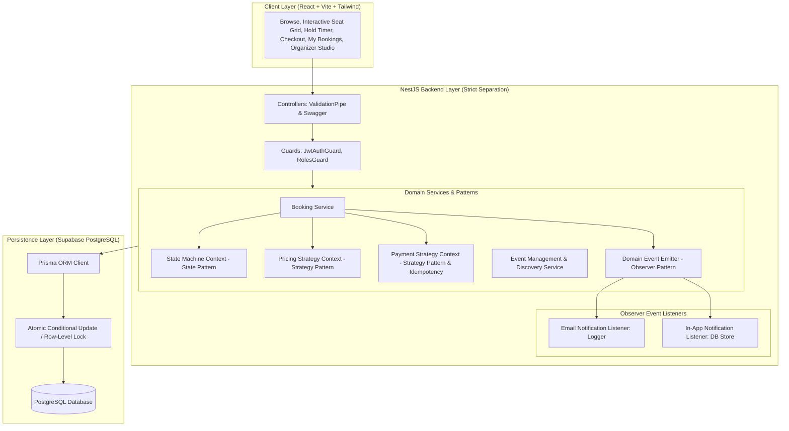

# TicketFlow — Event Ticket Booking System

[](https://github.com/saidulislam4d/TicketFlow/actions)


> **CPS Academy — InterviewQuest-3 Round 5 Assignment**  
> An enterprise-grade, high-concurrency event ticket booking platform modeled after Ticketmaster and BookMyShow. Built with Clean 3-Tier Layered Architecture, textbook GoF Design Patterns, strict SOLID principles, zero double-booking concurrency safety, and full CI/CD automation.

---

## 🌐 Live URLs & Demo Access

| Service | Live Hosted URL | Description |
|---|---|---|
| **Frontend Web App** | `https://ticketflow-client.vercel.app` *(Deploying)* | Full customer & organizer interactive interface |
| **Backend API** | `https://ticketflow-api.onrender.com` *(Deploying)* | REST API with centralized error handling & logging |
| **Interactive Swagger API Docs** | `https://ticketflow-api.onrender.com/api/docs` | Live OpenAPI documentation & API explorer |

### 🔑 Pre-Seeded Demo Credentials

The platform includes convenient **1-click quick login chips** in the top navigation bar for evaluators:

| Role | Email | Password | Permissions & Features |
|---|---|---|---|
| **Organizer** | `organizer@ticketflow.com` | `Password123!` | Create events, define dimensions ($rows \times seats$), set tier prices, select pricing strategy |
| **Customer 1** | `customer@ticketflow.com` | `Password123!` | Browse events, hold seats, test Mock Stripe/PayPal checkout, view bookings, test cancellation refund |
| **Customer 2** | `customer2@ticketflow.com` | `Password123!` | Test concurrent race conditions (simultaneous hold attempts on the same seat) |

---

## 🚀 Core Features (All 11 Mandatory Requirements)

1. **Authentication & RBAC**: Dual roles (`ORGANIZER`, `CUSTOMER`) secured via Passport JWT strategy and custom `@Roles()` guards.
2. **Event & Seat Map Management**: Organizers configure venues, dates, interactive dimensions ($rows \times seats$), and tiered pricing (VIP, Regular). Organizers can only manage their own events.
3. **Public Discovery**: Multi-parameter search (title, venue, city), city filtering, date ranges, and pagination with dynamic starting prices.
4. **Temporary Seat Hold (5 Minutes)**: Locks selected seats with a live 5:00 countdown timer. Automatically released upon expiration.
5. **Booking Lifecycle State Machine**: Strict transitions (`Held` $\rightarrow$ `Pending Payment` $\rightarrow$ `Confirmed` / `Expired` / `Cancelled`) with complete audit logging in `BookingStatusHistory`.
6. **Pluggable Payment Gateways (Strategy Pattern)**: Supports **Mock Stripe** and **Mock PayPal** behind a single `PaymentProcessor` interface. Switching providers requires zero changes to booking code. Includes **payment idempotency** against duplicate charges.
7. **Dynamic Pricing (Strategy Pattern)**: Supports **Standard** and **Early-Bird** (20% discount if reserved $\ge 7$ days prior to event). Organizer configures strategy per event.
8. **Decoupled Notifications (Observer Pattern)**: Asynchronous domain event dispatching (`booking.confirmed`, `booking.cancelled`) to **Email** (structured logger) and **In-App** (database notification center) without touching core booking logic.
9. **Zero Double-Booking Guarantee**: Concurrency-safe atomic conditional row updates eliminate race conditions. Tested under simultaneous multi-user load.
10. **Cancellation & Refund Rules**: Business rule engine issuing **100% full refund** if cancelled $> 24$ hours before event start, and **0% refund** if cancelled $\le 24$ hours. Automatically restores seats to `AVAILABLE`.
11. **Cross-Cutting Concerns**: Central exception filtering (`HttpExceptionFilter`), structured request duration logging (`LoggingInterceptor`), DTO validation pipes, and zero secrets in Git.

---

## 🏛️ System Architecture & Design Patterns



For complete technical documentation, pattern justifications, and SOLID compliance, see [ARCHITECTURE.md](file:///home/saidul/Desktop/Job%20Preparation/Project/TicketFlow/ARCHITECTURE.md).

---

## 🛠️ Tech Stack & Trade-Off Justifications

- **Frontend**: **React 18 (Vite) + Tailwind CSS + Lucide Icons**  
  *Justification*: Lightweight bundle, zero SSR overhead, instant rendering of dynamic seat grids, fast deployment to Vercel.
- **Backend**: **Node.js + NestJS (TypeScript)**  
  *Justification*: Clean 3-tier modular architecture out-of-the-box (`Controller` $\rightarrow$ `Service` $\rightarrow$ `Repository`), native Dependency Injection container for GoF patterns, built-in validation pipes, and Swagger documentation.
- **ORM**: **Prisma ORM**  
  *Justification*: Declarative relational modeling, type safety, automatic migrations, and support for raw atomic SQL queries.
- **Database**: **PostgreSQL (Supabase)**  
  *Justification*: Full ACID compliance, robust row-level locking for serialization, connection pooling via Supabase pooler.
- **Concurrency Control**: **Atomic Conditional Update (Optimistic Row Lock)**  
  *Justification*: Executes `UPDATE "Seat" SET ... WHERE status = 'AVAILABLE' OR (status = 'HELD' AND holdExpiresAt < NOW())`. Guarantees exactly one winner under race conditions without costly distributed table locks.
- **Hold Expiration**: **Lazy (Just-In-Time) Expiration**  
  *Justification*: Evaluates hold expiration dynamically on access and checkout. Eliminates dependency on fragile external cron workers that stall when free cloud containers sleep.

---

## 💻 Local Setup & Installation

### Prerequisites
- Node.js `v20.x` or higher
- npm `v10.x` or higher
- PostgreSQL database (or free Supabase project)

### 1. Clone the Repository
```bash
git clone https://github.com/saidulislam4d/TicketFlow.git
cd TicketFlow
```

### 2. Configure Environment Variables

**Backend (`backend/.env`):**
```bash
cp backend/.env.example backend/.env
```
*Configure `DATABASE_URL`, `DIRECT_URL`, and `JWT_SECRET` in `backend/.env`.*

**Frontend (`frontend/.env`):**
```bash
cp frontend/.env.example frontend/.env
```
*Set `VITE_API_URL="http://localhost:4000"` in `frontend/.env`.*

### 3. Install Dependencies
```bash
# Install backend dependencies
cd backend && npm install

# Install frontend dependencies
cd ../frontend && npm install
```

### 4. Run Database Migrations & Seed Demo Data
```bash
cd ../backend

# Generate Prisma Client
npm run prisma:generate

# Push schema to database
npx prisma db push

# Seed demo accounts and showcase events with interactive seat maps
npm run seed
```

### 5. Start Development Servers
From the repository root:
```bash
# Terminal 1: Start Backend (http://localhost:4000)
npm run dev:backend

# Terminal 2: Start Frontend (http://localhost:5173)
npm run dev:frontend
```

---

## 🧪 Running Tests & Concurrency Verification

TicketFlow comes with comprehensive unit and concurrency test suites:

```bash
cd backend

# Run all 44 unit tests across 10 test suites
npm run test

# Run test suite with full coverage reporting
npm run test:cov
```

### Concurrency Test Highlight (`concurrency-hold.spec.ts`)
Validates that when **10 concurrent users simultaneously attempt to hold the exact same seat**, exactly 1 user succeeds (HTTP 201) and the other 9 receive `409 ConflictException`.

---

## 📂 Project Directory Structure

```text
TicketFlow/
├── .github/
│   └── workflows/
│       └── ci.yml                     # GitHub Actions CI (Lint, Test, Build)
├── backend/                           # NestJS Backend API
│   ├── prisma/
│   │   ├── schema.prisma              # Relational schema (Supabase PostgreSQL)
│   │   └── seed.ts                    # Demo accounts & event seat maps seeder
│   ├── src/
│   │   ├── common/                    # Filters (HttpExceptionFilter), Interceptors (Logging)
│   │   ├── modules/
│   │   │   ├── auth/                  # JWT auth, Passport strategy, RBAC RolesGuard
│   │   │   ├── events/                # Event CRUD, seat grid generator, public search
│   │   │   ├── bookings/              # Concurrency seat hold, State Pattern lifecycle
│   │   │   ├── pricing/               # Strategy Pattern: Standard & Early-Bird pricing
│   │   │   ├── payments/              # Strategy Pattern: Mock Stripe & Mock PayPal + Idempotency
│   │   │   └── notifications/         # Observer Pattern: Email & In-App notification listeners
│   │   ├── prisma/                    # Injectable PrismaService & global PrismaModule
│   │   ├── app.module.ts              # Root NestJS module
│   │   └── main.ts                    # Bootstrap with Swagger, CORS, & global pipes
│   ├── test/                          # End-to-end and concurrency test suites
│   ├── package.json
│   └── tsconfig.json
├── frontend/                          # React + Vite + Tailwind CSS Client
│   ├── src/
│   │   ├── components/                # Navbar, AuthModal, CheckoutModal, NotificationModal
│   │   ├── context/                   # AuthContext with 1-click demo accounts
│   │   ├── pages/                     # EventBrowsePage, EventDetailsPage, MyBookingsPage, OrganizerDashboardPage
│   │   ├── services/                  # Unified authenticated ApiClient
│   │   ├── types/                     # Shared TypeScript interfaces
│   │   ├── App.tsx                    # Root application component
│   │   └── main.tsx                   # React DOM bootstrapping
│   ├── package.json
│   ├── tailwind.config.js
│   └── vite.config.ts
├── README.md                          # Project overview, setup, and credentials
├── ARCHITECTURE.md                    # Deep-dive architecture and design patterns
├── AI_USAGE.md                        # AI usage transparency disclosure
└── WORKFLOW_LOG.md                    # Step-by-step development log
```

---

## 📜 License
Developed by **Md. Saidul Islam** for the **CPS Academy InterviewQuest-3 Coding Contest**. MIT Licensed.
